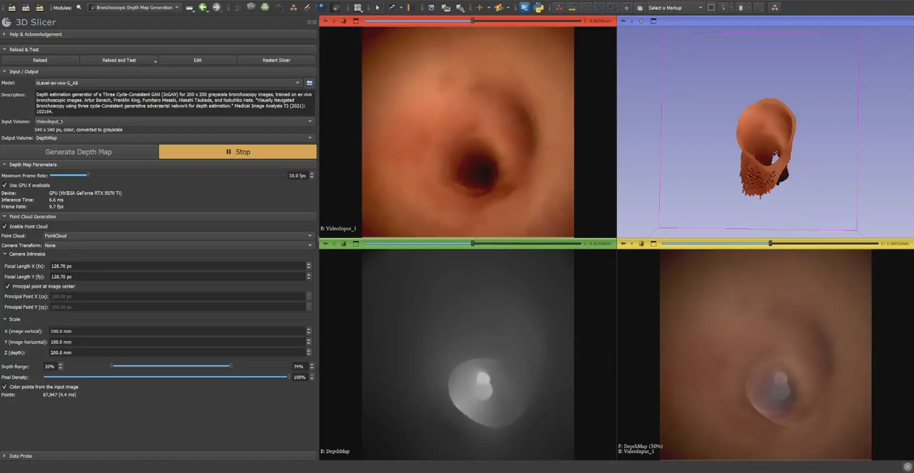
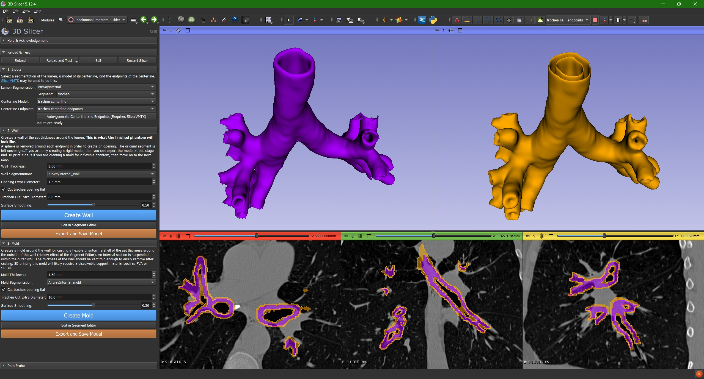

# BronchoTools

3D Slicer extension containing tools for image-guided bronchoscopy.

## Modules

- **Video Input**: Streams frames from a webcam, video file, or image sequence into a volume node.
- **Bronchoscopic Depth Map Generation**: Estimates a depth map from a 2D bronchoscopic image with a deep learning model,
  once or continuously on a live image (e.g. from Video Input). It is intended for monoscopic (single camera) bronchoscope
  footage. The depth map can be converted into a point cloud using the camera intrinsics.
- **Endoluminal Phantom Builder**: Helps create a physical phantom of an endoluminal structure (e.g. the airways) from a
  segmentation of the lumen, step by step:
  1. **Inputs**: the lumen segmentation, its centerline model, and the centerline endpoints. The centerline model and endpoints can be made with the Extract Centerline module of [SlicerVMTK](https://github.com/vmtk/SlicerExtension-VMTK) from within the module, if that extension is installed.
  2. **Wall**: a wall of a set thickness around the lumen, which is what the finished phantom looks like. It can be 3D printed as-is as a rigid phantom.
  3. **Mold**: a shell of a set thickness that encloses the wall for casting a flexible phantom.

  

## Installation (development)

Add the module folders (e.g. `SlicerBronchoTools/VideoInput`) to 3D Slicer's Additional module paths
(Edit > Application Settings > Modules), then restart Slicer.

## Dependencies

- **Video Input**: `opencv-python-headless`, `cv2_enumerate_cameras` (both will be installed on first use)
- **Bronchoscopic Depth Map Generation**: PyTorch which can be installed with the Slicer [PyTorch extension](https://github.com/fepegar/SlicerPyTorch). Model weights are downloaded into Slicer's cache folder on first use.
- **Endoluminal Phantom Builder**: Automatically generating the centerline requires the [SlicerVMTK](https://github.com/vmtk/SlicerExtension-VMTK) extension.

## Sample data

A short porcine bronchoscopy recording is included with the Bronchoscopic Depth Map Generation module in the
`Resources/SampleData` folder:

- `porcine.mkv`: the video
- `porcine_frames/`: its 90 frames as JPEG images

## Testing

Each module contains a self-test (e.g. `VideoInputTest` in `VideoInput/VideoInput.py`). In Slicer, enable developer mode
(Edit > Application Settings > Developer) and press **Reload and Test** in the module.

## License

BSD 3-Clause. See [LICENSE](LICENSE).
